# TechCollab

**One platform for tech freelancing, events and community.**

Startups, developers and tech communities usually juggle a freelancing
marketplace, an event platform and a chat app. TechCollab brings them together:
clients post gigs and hire freelancers, organizers run hackathons, meetups and
webinars, and members collaborate in community spaces. It started as a
hackathon project ([original brief](docs/problem-statement.md)).


**Who it's for**

- **Clients and startups** who need to hire tech talent for well-defined projects
- **Freelancers** looking for gigs that match their skills
- **Community organizers** running hackathons, meetups and webinars

## Screenshots

These were captured from the running app with demo seed data.

| Landing page                                           | Events (public)                                                                                                                                                           |
| ------------------------------------------------------ | ------------------------------------------------------------------------------------------------------------------------------------------------------------------------- |
| 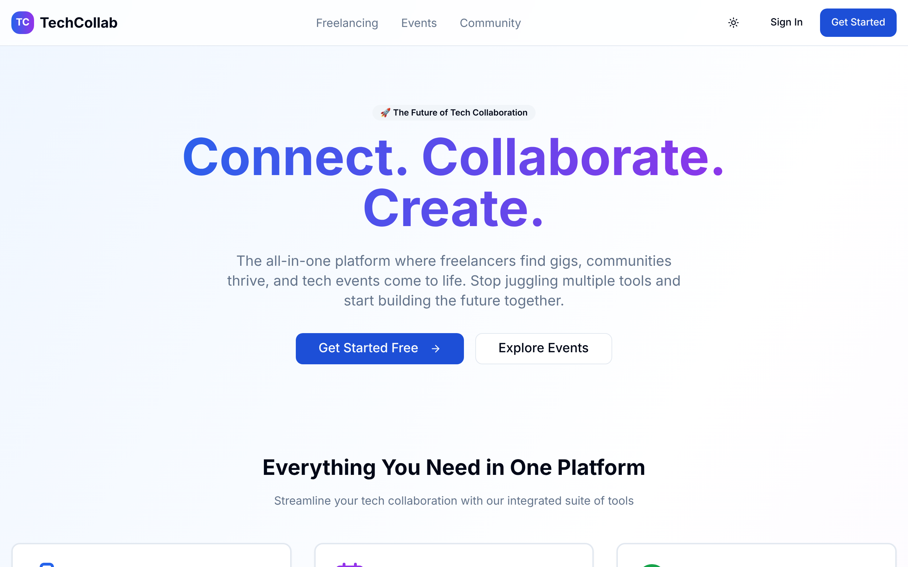          | 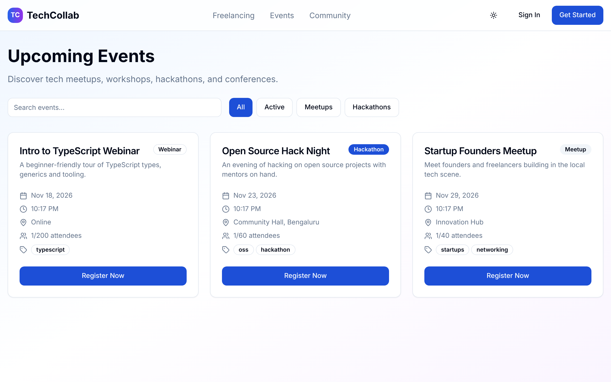                                                                                                                            |
| **Client dashboard**                                   | **Client: manage posted projects**                                                                                                                                        |
| 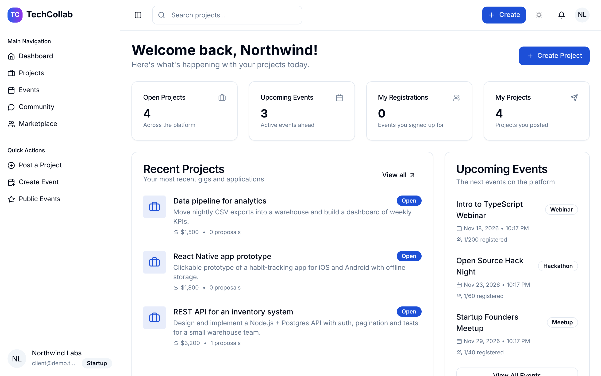           | 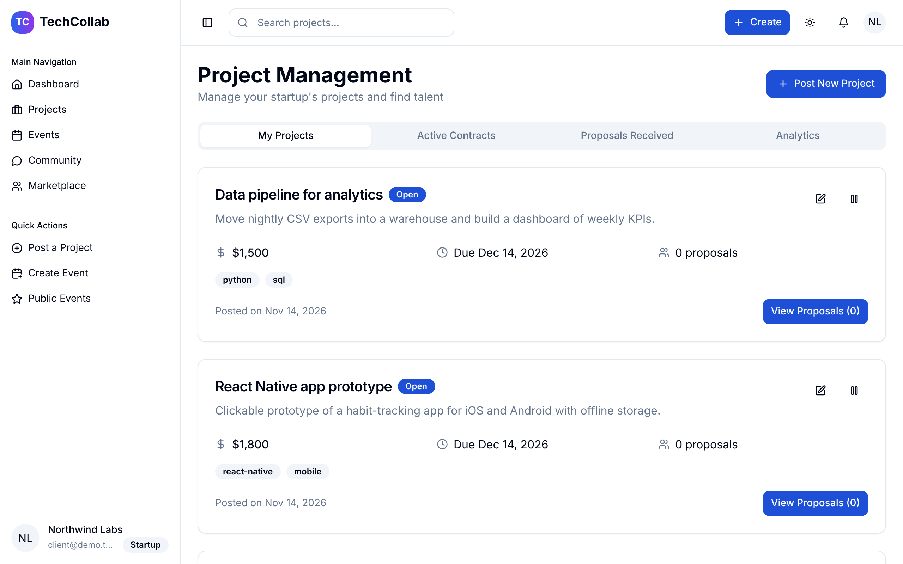                                                                                                                  |
| **Freelancer: gig detail with proposal status**        | **Freelancer: find work (dark mode)**                                                                                                                                     |
| 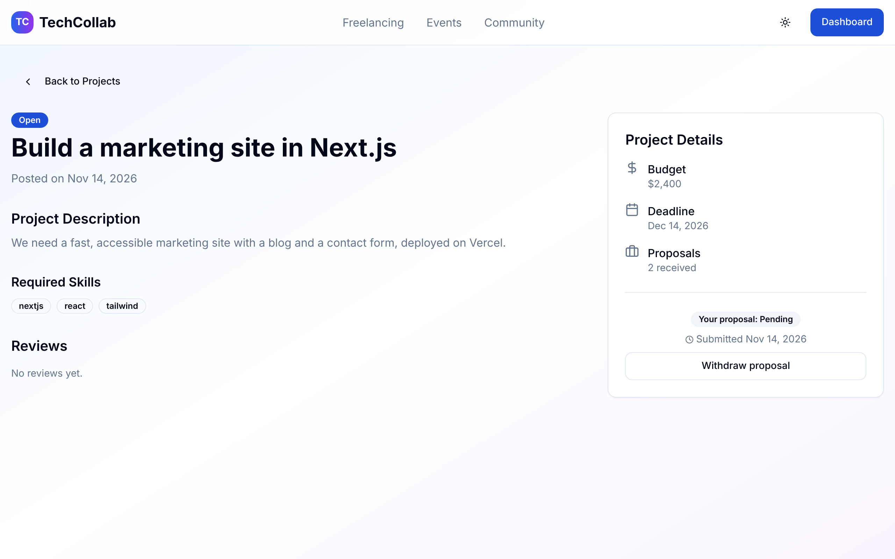         | 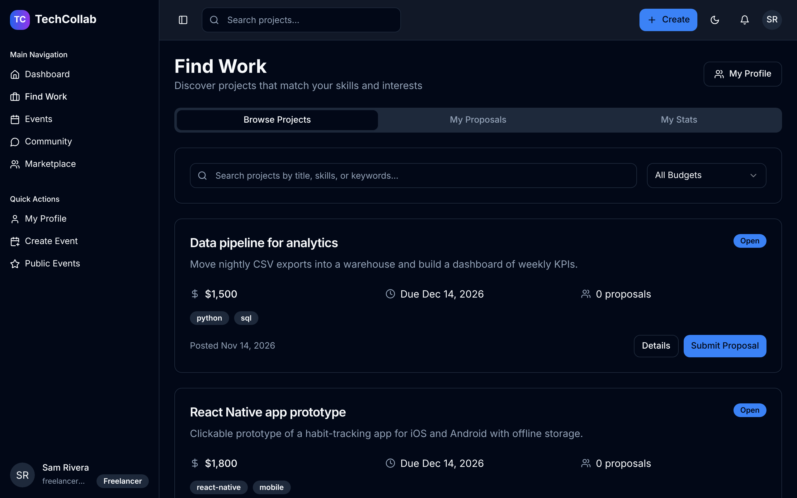                                                                                                           |
| **Organizer: event management and check-in**           | **Mobile (375px)**                                                                                                                                                        |
| 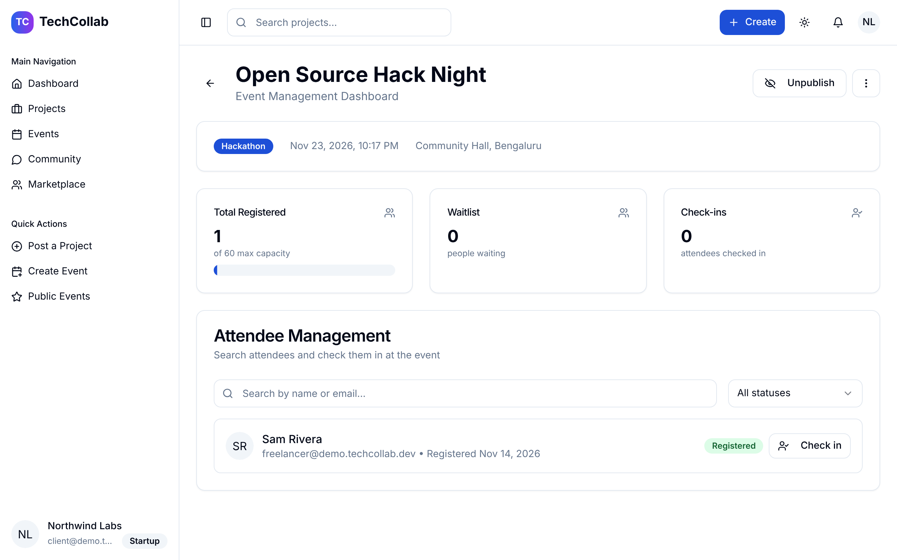 | 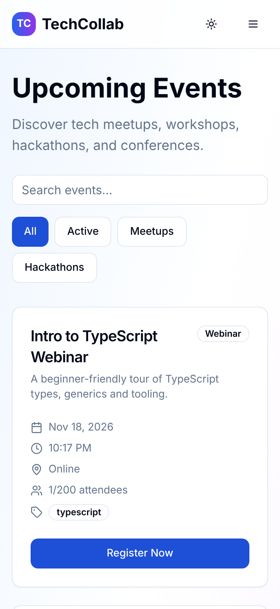 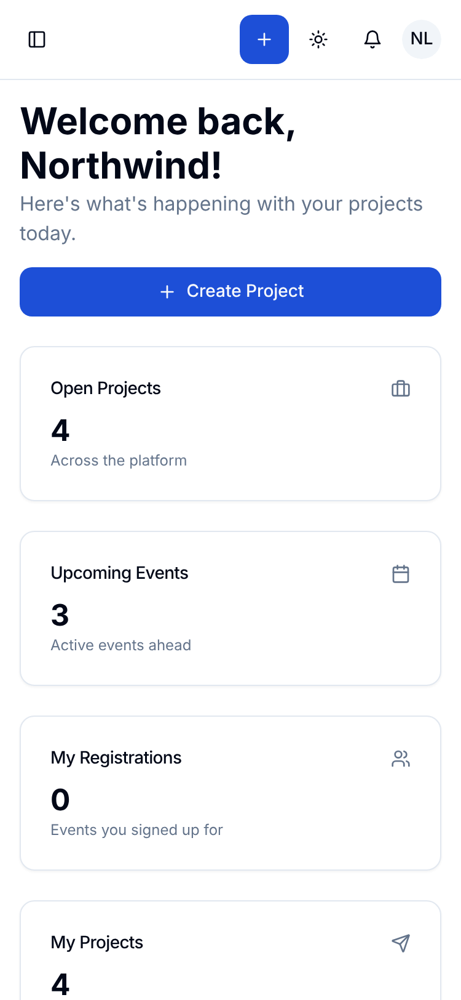 |

## Features

**Freelancing** (`freelance-service`)

- Clients and startups post gigs with budget, required skills and deadline
- Full-text and skill search with pagination
- Freelancers submit proposals (cover letter, bid, timeline), then edit or
  withdraw them while they are still pending
- Gig owners accept or reject proposals. Accepting one starts the gig and
  rejects the other bids
- After a gig is completed, the client and the hired freelancer can review
  each other (1–5 stars), once each
- Dashboards for clients and freelancers, plus platform stats for admins

**Events** (`event-service`)

- Create hackathons, meetups, webinars, conferences and workshops, with a
  venue or an online link, capacity, tags and a cover image
- Draft or published events. Drafts are visible only to their organizer
- Registration with capacity limits and an automatic waitlist. Waitlisted
  users are promoted when a seat frees up or capacity is raised
- Organizer tools: attendee list and attendance check-in

**Accounts** (`user-service`)

- Email/password sign-up as a freelancer, client or startup, with bcrypt
  password hashing
- JWT sign-in. The other services verify the same token, so no
  service-to-service call is needed per request
- Profile endpoint for restoring sessions and editing your bio and skills

**Web app** (`frontend`)

- Next.js App Router UI with a landing page, auth flows and a dashboard for
  freelancing, events and community
- Dark and light themes, responsive layout, shadcn/ui components

> **Community chat status:** the community and chat screens in the frontend
> currently run on client-side demo data (`lib/chat-context.tsx`). No backend
> chat or WebSocket service exists yet. See [Roadmap](#roadmap).

## Tech stack

| Layer     | Technology                                                 |
| --------- | ---------------------------------------------------------- |
| Frontend  | Next.js 15 (App Router), React 19, Tailwind CSS, shadcn/ui |
| Backend   | Node.js 20, Express 5, TypeScript, Zod validation          |
| Database  | PostgreSQL 16 via TypeORM                                  |
| Auth      | JWT (`jsonwebtoken`), bcrypt                               |
| Tooling   | ESLint 9, Prettier, Jest + Supertest, Vitest               |
| Packaging | Multi-stage Dockerfiles per service, Docker Compose        |

## Architecture

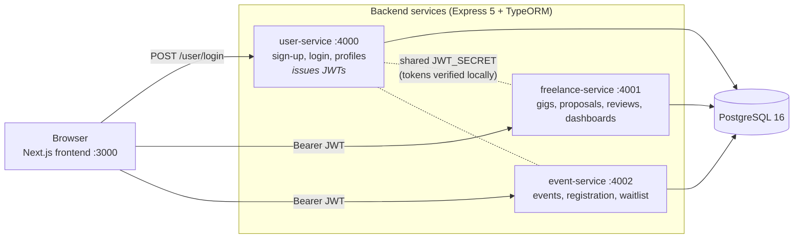

Request lifecycle inside a service:

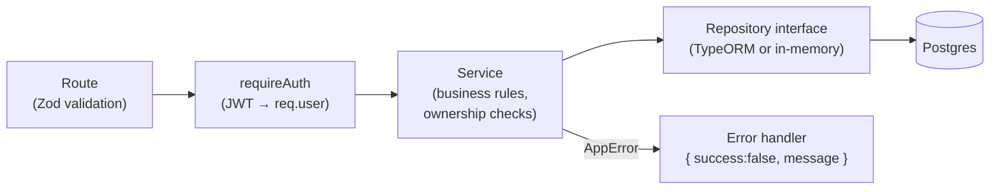

- **Independent services.** Each backend is its own npm package with its own
  Dockerfile, so you can deploy and scale them separately. They share one
  Postgres database but use separate tables.
- **Stateless auth.** `user-service` signs a JWT holding `{ id, name, email,
type }`. The other services check the signature locally with the same
  `JWT_SECRET` and take the caller's identity from the token, never from the
  request body.
- **Layering inside each service:** `routes` (HTTP and Zod validation) →
  `services` (business rules and authorization) → `repository` (TypeORM data
  access behind an interface). The tests swap in in-memory repositories, so
  the business rules are tested without a database.
- **Consistent errors.** Every service returns
  `{ success: false, message: "<CODE>" }` with a matching HTTP status.
  Validation failures return `400` with a field-level `errors` array.

## Getting started

### Prerequisites

- Node.js 20.19+ (22 LTS recommended; the frontend test tooling needs a recent Node) and npm 10+
- PostgreSQL 14+ (or Docker)

### Option A: Docker Compose (everything)

```bash
cp .env.example .env          # then set POSTGRES_PASSWORD and JWT_SECRET
docker compose up --build
```

| URL                   | What              |
| --------------------- | ----------------- |
| http://localhost:3000 | Web app           |
| http://localhost:4000 | user-service      |
| http://localhost:4001 | freelance-service |
| http://localhost:4002 | event-service     |
| localhost:5433        | Postgres (host)   |

Tables are created automatically on first start (`DB_SYNCHRONIZE=true`).

### Option B: run locally

```bash
# 1. Database
createdb techcollab              # or: docker compose up -d postgres

# 2. Install dependencies for every package
npm run install:all

# 3. Configure each service (edit DB credentials and use one JWT_SECRET everywhere)
for s in user-service freelance-service event-service; do
  cp packages/$s/.env.example packages/$s/.env
done
cp packages/frontend/.env.example packages/frontend/.env.local

# 4. Start the services (one terminal each)
npm --prefix packages/user-service run dev
npm --prefix packages/freelance-service run dev
npm --prefix packages/event-service run dev
npm --prefix packages/frontend run dev
```

## Environment variables

Backend services (see `packages/<service>/.env.example`):

| Variable         | Default                 | Description                                                   |
| ---------------- | ----------------------- | ------------------------------------------------------------- |
| `PORT`           | 4000 / 4001 / 4002      | HTTP port                                                     |
| `JWT_SECRET`     | — **required**          | Secret for signing and verifying tokens; same in all services |
| `DB_HOST`        | `localhost`             | Postgres host                                                 |
| `DB_PORT`        | `5432`                  | Postgres port                                                 |
| `DB_USERNAME`    | `postgres`              | Postgres user                                                 |
| `DB_PASSWORD`    | _(empty)_               | Postgres password                                             |
| `DB_DATABASE`    | `techcollab`            | Database name                                                 |
| `DB_SYNCHRONIZE` | `true`                  | Auto-create/update tables from entities                       |
| `DB_LOGGING`     | `false`                 | Log SQL queries                                               |
| `CORS_ORIGIN`    | `http://localhost:3000` | Comma-separated browser origins allowed to call the API       |
| `LOG_LEVEL`      | `info`                  | Winston log level (JSON logs when `NODE_ENV=production`)      |
| `JWT_EXPIRES_IN` | `1h`                    | _user-service only:_ token lifetime                           |
| `BCRYPT_ROUNDS`  | `10`                    | _user-service only:_ password hashing cost                    |

Frontend (`packages/frontend/.env.example`). These values are baked into the
build:

| Variable                            | Default                 |
| ----------------------------------- | ----------------------- |
| `NEXT_PUBLIC_USER_SERVICE_URL`      | `http://localhost:4000` |
| `NEXT_PUBLIC_FREELANCE_SERVICE_URL` | `http://localhost:4001` |
| `NEXT_PUBLIC_EVENT_SERVICE_URL`     | `http://localhost:4002` |

Docker Compose reads the root `.env` (see `.env.example`):
`POSTGRES_USER`, `POSTGRES_PASSWORD`, `POSTGRES_DB`, `JWT_SECRET`,
`JWT_EXPIRES_IN`, `CORS_ORIGIN` and the three `NEXT_PUBLIC_*` URLs.

## Scripts

From the repository root (each runs in every package, in order):

```bash
npm run install:all    # npm ci everywhere
npm run lint           # ESLint
npm run typecheck      # tsc --noEmit
npm test               # Jest (backends) and Vitest (frontend)
npm run build          # compile backends, production Next.js build
npm run format:check   # Prettier
```

Inside a package: `npm run dev`, `npm run build`, `npm start`, `npm test`,
`npm run lint`, `npm run format`.

## API overview

All responses are JSON. 🔒 means `Authorization: Bearer <token>` is required.

<details>
<summary><strong>user-service</strong> (:4000)</summary>

| Method | Path                    | Description                                                  |
| ------ | ----------------------- | ------------------------------------------------------------ |
| POST   | `/user/signup`          | `{ name, email, password, type? }` → `201 { success, user }` |
| POST   | `/user/login`           | `{ email, password }` → `{ success, token, user }`           |
| GET    | `/user/profile` 🔒      | Current user's profile                                       |
| PATCH  | `/user/profile` 🔒      | Update `name`, `bio`, `skills`                               |
| GET    | `/auth/verify-token` 🔒 | Decode and verify a token                                    |
| GET    | `/health`               | Liveness check                                               |

`type` is one of `freelancer` (default), `client` or `startup`. Admin
accounts cannot be created through sign-up.

</details>

<details>
<summary><strong>freelance-service</strong> (:4001)</summary>

| Method | Path                                                                                                | Who                                           |
| ------ | --------------------------------------------------------------------------------------------------- | --------------------------------------------- |
| GET    | `/gigs?page&limit&status`                                                                           | Public                                        |
| GET    | `/gigs/search?query&skills=a,b`                                                                     | Public                                        |
| GET    | `/gigs/:id`, `/gigs/client/:clientId`                                                               | Public                                        |
| POST   | `/gigs` 🔒                                                                                          | Clients, startups, admins                     |
| PUT    | `/gigs/:id` 🔒, DELETE `/gigs/:id` 🔒                                                               | Gig owner or admin                            |
| POST   | `/proposals` 🔒                                                                                     | Any user except the gig owner                 |
| GET    | `/proposals/gig/:gigId` 🔒                                                                          | Gig owner or admin                            |
| GET    | `/proposals/freelancer/:id` 🔒                                                                      | That freelancer or admin                      |
| GET    | `/proposals/:id` 🔒                                                                                 | Author, gig owner or admin                    |
| PUT    | `/proposals/:id` 🔒                                                                                 | Author edits/withdraws; owner accepts/rejects |
| DELETE | `/proposals/:id` 🔒                                                                                 | Author or admin                               |
| GET    | `/reviews`, `/reviews/:id`, `/reviews/gig/:gigId`, `/reviews/reviewer/:id`, `/reviews/reviewee/:id` | Public                                        |
| POST   | `/reviews` 🔒                                                                                       | Client or hired freelancer of a completed gig |
| DELETE | `/reviews/:id` 🔒                                                                                   | Review author or admin                        |
| GET    | `/dashboard/client/:id` 🔒, `/dashboard/freelancer/:id` 🔒                                          | That user or admin                            |
| GET    | `/dashboard/admin/stats` 🔒                                                                         | Admin                                         |

</details>

<details>
<summary><strong>event-service</strong> (:4002)</summary>

| Method | Path                                                | Who                                      |
| ------ | --------------------------------------------------- | ---------------------------------------- |
| GET    | `/events?eventType&upcoming&organizerId&page&limit` | Public (drafts only for their organizer) |
| GET    | `/events/:id`                                       | Public if published                      |
| POST   | `/events` 🔒                                        | Any signed-in user                       |
| PUT    | `/events/:id` 🔒, DELETE `/events/:id` 🔒           | Organizer or admin                       |
| POST   | `/events/:id/register` 🔒                           | Signed-in user                           |
| POST   | `/events/:id/cancel` 🔒                             | The registered user                      |
| GET    | `/events/:id/attendees` 🔒                          | Organizer or admin                       |
| POST   | `/events/attendees/:attendeeId/mark-attendance` 🔒  | Organizer or admin                       |
| GET    | `/events/user/:userId` 🔒                           | That user or admin                       |

</details>

## Usage

### Web app walkthrough

1. Open http://localhost:3000 and **Get Started**. Sign up as a _Client_,
   _Startup_ or _Freelancer_.
2. **Clients and startups**: go to _Post a Project_ to create a gig. Then
   open _Projects → View Proposals_ to accept or reject bids. Accepting a bid
   moves the gig to _In progress_. When the work is done, mark the gig
   completed and leave a review.
3. **Freelancers**: browse _Find Work_, open a gig and submit a proposal.
   Track it under _My Proposals_, where you can withdraw it while it is
   pending.
4. **Anyone**: create an event from _Create Event_, share it, and use
   _Manage_ to check attendees in or export them to CSV. Others register
   from the public _Events_ page. When an event is full, new registrations
   join the waitlist.

### API examples

```bash
# Sign up and log in
curl -s -X POST localhost:4000/user/signup -H 'Content-Type: application/json' \
  -d '{"name":"Ada","email":"ada@example.com","password":"password123","type":"client"}'
# → 201 {"success":1,"user":{"id":"…","name":"Ada","email":"ada@example.com","type":"client",…}}

TOKEN=$(curl -s -X POST localhost:4000/user/login -H 'Content-Type: application/json' \
  -d '{"email":"ada@example.com","password":"password123"}' | jq -r .token)

# Post a gig (clientId comes from the token)
curl -s -X POST localhost:4001/gigs -H "Authorization: Bearer $TOKEN" \
  -H 'Content-Type: application/json' \
  -d '{"title":"Build a landing page","description":"Responsive marketing page in Next.js.","budget":500,"requiredSkills":["react"]}'
# → 201 {"success":true,"data":{"id":"…","status":"open","budget":500,…}}

# Search gigs (public)
curl -s 'localhost:4001/gigs/search?query=landing&skills=react,nextjs'
# → {"success":true,"data":[…],"pagination":{"total":1,"page":1,"limit":10,"pages":1}}

# Create an event and register for it
EVENT=$(curl -s -X POST localhost:4002/events -H "Authorization: Bearer $TOKEN" \
  -H 'Content-Type: application/json' \
  -d '{"title":"Hack Night","description":"Hacking on open source together","startDateTime":"2030-01-20T18:00:00Z","eventType":"HACKATHON","maxAttendees":50}' \
  | jq -r .event.id)
curl -s -X POST localhost:4002/events/$EVENT/register -H "Authorization: Bearer $TOKEN"
# → {"success":true,"message":"SUCCESSFULLY_REGISTERED","attendee":{…}}
```

Errors share one shape:

```json
{
  "success": false,
  "message": "VALIDATION_ERROR",
  "errors": [{ "path": "title", "message": "Title must be at least 5 characters" }]
}
```

Common codes: `AUTHENTICATION_REQUIRED` / `INVALID_TOKEN` (401),
`FORBIDDEN` / `NOT_GIG_OWNER` / `NOT_EVENT_ORGANIZER` (403), `*_NOT_FOUND`
(404), `USER_EXISTS` / `ALREADY_APPLIED` / `ALREADY_REGISTERED` (409).

## Testing

- **Backends:** Jest + Supertest exercise each service's real Express app,
  routing, validation, auth and business rules against in-memory
  repositories, so no database is needed (`npm test` in each package).
- **Frontend:** Vitest and Testing Library tests cover the API client
  (response shapes, auth headers, network and validation errors), auth
  storage, the session-restoring `AuthProvider`, dashboard helpers and
  formatting utilities.

```bash
npm test                                   # everything
npm --prefix packages/freelance-service test -- --coverage
npm --prefix packages/frontend run test:watch
```

**Lint and format:** ESLint 9 flat configs (typescript-eslint for the
backends, `eslint-config-next` for the frontend) and a shared Prettier
config. Run `npm run lint` and `npm run format:check` from the root.

## Deployment

- **Backends.** Each service has a multi-stage `Dockerfile` (Node 20 Alpine,
  production dependencies only, non-root user, `HEALTHCHECK` on `/health`).
  Deploy them to any container host (Render, Railway, Fly.io, ECS, Kubernetes)
  with the environment variables above. Give every service the same
  `JWT_SECRET`.
- **Frontend.** Builds as a Next.js `standalone` server (Docker) or deploys
  to Vercel. Set the `NEXT_PUBLIC_*` URLs to the public API addresses
  **before** building, and add the frontend's origin to each service's
  `CORS_ORIGIN`.
- **Database.** In production, set `DB_SYNCHRONIZE=false` once you manage the
  schema with TypeORM migrations, so that entity changes cannot alter tables
  unexpectedly.

## Project structure

```
.
├── docker-compose.yml          # Postgres + 3 APIs + web app
├── .env.example                # Compose configuration template
├── package.json                # Root scripts that run in every package
├── scripts/each-package.mjs
├── docs/problem-statement.md   # Original hackathon brief
└── packages/
    ├── user-service/           # Accounts and JWT issuing
    ├── freelance-service/      # Gigs, proposals, reviews, dashboards
    ├── event-service/          # Events, registration, waitlist
    │   ├── src/
    │   │   ├── app.ts          # Express app factory (dependency-injected)
    │   │   ├── server.ts       # DB connect, listen, graceful shutdown
    │   │   ├── config/         # Env parsing
    │   │   ├── common/         # Logger, AppError + error handler
    │   │   ├── middleware/     # JWT auth
    │   │   ├── models/         # TypeORM entities
    │   │   ├── repository/     # Repository interfaces + TypeORM impl
    │   │   ├── services/       # Business rules and authorization
    │   │   ├── routes/         # HTTP handlers
    │   │   └── validations/    # Zod schemas
    │   └── tests/              # Jest + Supertest
    └── frontend/               # Next.js web app
        ├── app/                # App Router pages
        ├── components/         # UI (shadcn/ui in components/ui)
        └── lib/                # API client, auth, contexts, helpers
```

## Troubleshooting

| Problem                                                                 | Fix                                                                                                                              |
| ----------------------------------------------------------------------- | -------------------------------------------------------------------------------------------------------------------------------- |
| A service exits with `Missing required environment variable JWT_SECRET` | Copy `.env.example` to `.env` (in the service folder, or at the root for Compose) and set `JWT_SECRET`.                          |
| Login works but the other services return `401 INVALID_TOKEN`           | Every backend must use the **same** `JWT_SECRET`.                                                                                |
| The browser reports a CORS error                                        | Add the frontend's origin to `CORS_ORIGIN` on each backend (comma-separated for several).                                        |
| The frontend calls the wrong API URL                                    | `NEXT_PUBLIC_*` values are baked in at build time, so rebuild the frontend after changing them.                                  |
| `ECONNREFUSED 127.0.0.1:5432`                                           | Postgres isn't running, or `DB_HOST`/`DB_PORT` are wrong. With Compose, the database is exposed on host port **5433**.           |
| `npm ci` fails in the frontend with peer-dependency errors              | Use `npm ci --legacy-peer-deps` (some UI libraries have not declared React 19 support yet).                                      |
| `next start` warns about `output: standalone`                           | This is expected. The Docker image runs `node server.js` from `.next/standalone`, and `next start` still works for local checks. |
| Registering for an event returns `EVENT_NOT_AVAILABLE`                  | The event is a draft or deactivated. Publish it from the management page.                                                        |

## Known limitations

- Community chat, groups and media sharing are a front-end demo with mock
  data. Nothing is persisted or shared between users yet.
- The schema is managed by TypeORM `synchronize`; there are no migrations.
- Event capacity is checked with count-then-insert, so heavy concurrent
  sign-ups could briefly exceed `maxAttendees`.
- No password reset, email verification or OAuth sign-in yet.
- Tokens live in `localStorage`. An httpOnly-cookie session would be more
  resistant to XSS.

## Roadmap

- Real-time community chat backend (Socket.IO or similar) to replace the
  frontend demo data
- TypeORM migrations instead of schema synchronization
- Transactions or row locks around event registration, so capacity holds
  under concurrent sign-ups
- Payments, event reminder emails and gig recommendations (bonus items from
  the original brief)

## Contributing

1. Create a feature branch from `dev`.
2. Keep each service's layering (routes → services → repository) and add
   tests next to the existing ones in `tests/`.
3. Before opening a pull request, run from the root:
   `npm run lint && npm run typecheck && npm test && npm run build`.
4. Use [Conventional Commits](https://www.conventionalcommits.org/)
   (`feat:`, `fix:`, `docs:` …).

## License

No license has been chosen yet, so all rights are reserved by default.
Add a `LICENSE` file (for example, MIT) before accepting outside
contributions or reusing the code elsewhere.
